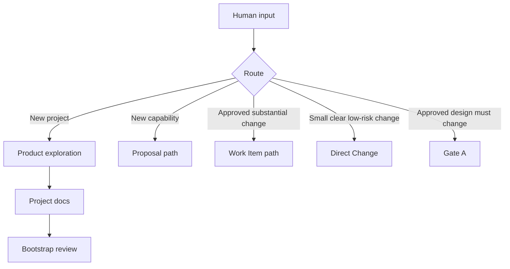
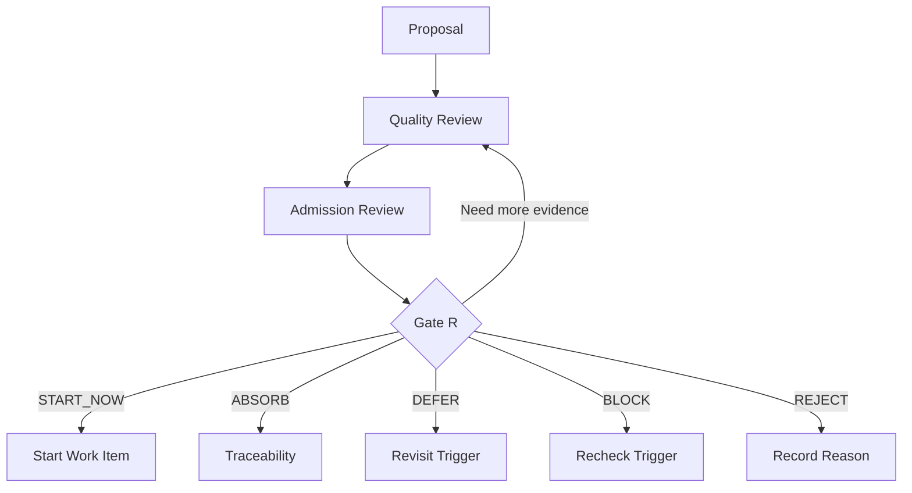
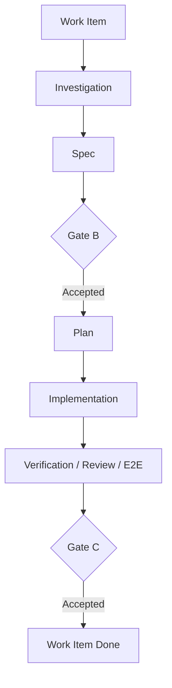
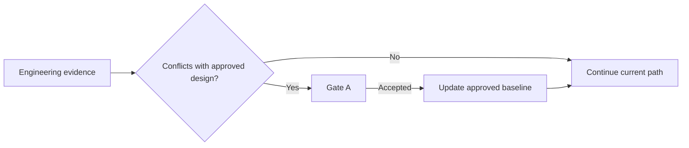
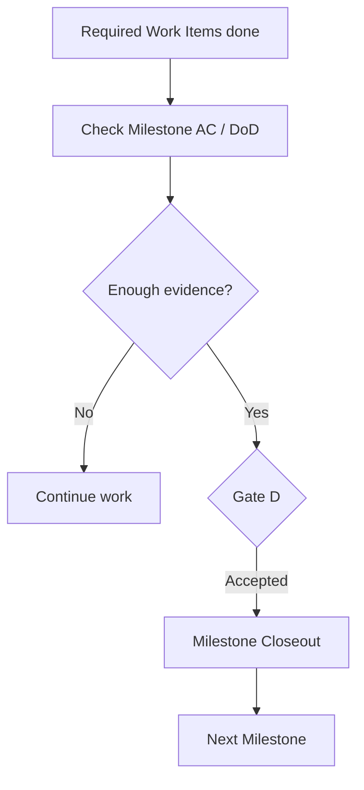

# Cortex Protocol v2

> **Human intent. Agent judgment. Repository truth. Right-sized process.**

Cortex Protocol 是一套面向 Human + Web ChatGPT + Coding Agent + Repository 的协作协议。

v2 的核心变化不是增加更多流程，而是把职责重新收敛：

```text
新项目
→ Web ChatGPT 讨论并生成 project docs
→ Coding Agent Bootstrap Review

已有项目的新能力
→ Proposal
→ Coding Agent Review
→ Gate R
→ Human 确认审查结论

正式 Work Item
→ Spec
→ Gate B
→ Plan / Implementation / Verification
→ Gate C

任何阶段发现已批准设计必须改变
→ Gate A interrupt

Milestone 的 Work Items + Acceptance Criteria 全部成立
→ Gate D
```

同时：

```text
小、明确、低风险的 bug / UI polish / refactor
→ Direct Change
→ 不强制 Spec + Plan
```

---

## 从哪里开始

### 第一次使用
- **按步骤跟做一遍**：[`tutorial/README.md`](tutorial/README.md)
- **把 starter template 放进真实项目**：[`START-HERE.md`](START-HERE.md)
- **直接浏览 starter template 内容**：[`starter-template/README.md`](starter-template/README.md)

### 理解协议
- **查正式协议**：[`PROTOCOL.md`](PROTOCOL.md)
- **浏览全部专题文档**：[`docs/README.md`](docs/README.md)
- **理解为什么这样设计**：[`WHY.md`](WHY.md)
- **查 Cortex 术语定义**：[`GLOSSARY.md`](GLOSSARY.md)

### 日常使用
- **直接复制 Prompt**：[`prompts/README.md`](prompts/README.md)
- **执行前 / 健康检查**：[`checklists/README.md`](checklists/README.md)
- **理解 Gate R / A / B / C / D**：[`docs/06-human-gates.md`](docs/06-human-gates.md)
- **四种日常 Coding 场景**：[`docs/12-four-coding-entry-scenarios.md`](docs/12-four-coding-entry-scenarios.md)
- **Architecture 到底放什么**：[`docs/15-architecture-documentation.md`](docs/15-architecture-documentation.md)
- **文档什么时候更新**：[`docs/13-document-update-timing.md`](docs/13-document-update-timing.md)

---

# 一、正式项目层级

v2 只有三个正式层级：

```text
Milestone
    ↓
Work Item
    ↓
Task
```

定义：

```text
Milestone
= Capability Atomic Unit
= 一整层完整用户能力

Work Item
= Change Atomic Unit
= 一个需要独立设计、实现、验证、验收的 coherent change

Task
= Implementation Atomic Unit
= Plan 内部的具体实施步骤
```

`Task` 不进入 `TODO.md`。

`Milestone` 默认记录在：

```text
docs/project/roadmap.md
```

不再保留 v1 的 `docs/stages/` 层级。

---

# 二、五个 Human Gate

## Gate R — Proposal Decision

Proposal 被 Coding Agent 完成 Review 后，**必须**把审查结论和建议交给 Human。

Coding Agent 可以建议：

```text
START_NOW
ABSORB
DEFER
BLOCK
REJECT
```

但这些只是 Agent recommendation，不是最终 disposition。

Human 要确认：

- `START_NOW`：是不是现在开始做？
- `ABSORB`：是否同意它已经被现有计划/能力覆盖？
- `DEFER`：是否同意“以后做”的理由和 Revisit Trigger？
- `BLOCK`：是否同意当前 blocker 判断以及需要什么证据再复查？
- `REJECT`：是否同意不做的理由？

**未经 Gate R Human 确认，不自动归档 Proposal，不自动把它写进 Roadmap，也不自动开始实现。**

如果 Human 不同意，可以：

```text
OVERRIDE
REQUEST_MORE_REVIEW
REVISE_PROPOSAL
```

---

## Gate A — Design Divergence

如果真实工程证据表明以下已经批准的内容需要实质调整：

- project design；
- 当前 Milestone 的 scope / Acceptance Criteria；
- 当前 approved change design（例如 Gate B accepted Spec）；

立即停止受影响实现并请求 Human 审查。

Gate A 是 **interrupt**，不是正常顺序中的下一步。

---

## Gate B — Spec Review

正式 Work Item 的 Spec 收敛后，由 Human 审：

> **这个系统行为是不是我要的？**

不审 implementation task decomposition。

---

## Gate C — Feature / Work Item Acceptance

Work Item 实现、自动验证、review 和适用 E2E 后，由 Human 从真实入口验收：

> **这个真实功能是不是我要的？**

Human accepted 前不得 Work Item Done。

---

## Gate D — Milestone Acceptance

当当前 Milestone 的：

```text
Work Items
+
Acceptance Criteria / Definition of Done
```

都已有证据满足时，由 Human 判断：

> **这一整层用户能力真的完整交付了吗？**

accepted 后才能执行 Milestone closeout，并进入下一 Milestone。

---

# 三、流程图：按问题拆开看

下面不再使用一张覆盖全部协议的大图。每张图只回答一个问题，避免节点过多导致字体缩小。

## 3.1 收到需求后，先走哪条路？



Human 不需要先替 Agent 分类。Human 描述真实意图，Coding Agent 根据 Repository truth 选择最小正确路径。

---

## 3.2 Proposal 如何经过 Gate R？



关键点：

> Coding Agent 只负责给 recommendation；`START_NOW / ABSORB / DEFER / BLOCK / REJECT` 都必须由 Human 在 Gate R 确认。

---

## 3.3 正式 Work Item 怎么走？



Gate B 审“应该怎样工作”，Gate C 验“真实功能是不是我要的”。

### Gate A 是 interrupt，不是正常下一步



Investigation、Spec、Plan、Coding、Testing、Review、Gate C feedback 中任何位置都可能触发 Gate A。

---

## 3.4 Milestone 什么时候真正完成？



最后一个 Work Item Done 不等于 Milestone 自动完成；必须回到 Milestone 的 User Capability 和 Acceptance Criteria，并经 Gate D。

---

# 四、不是每次改代码都要 Spec + Plan

正式 Work Item 才默认进入：

```text
Investigation
→ Spec
→ Gate B
→ Plan
→ Implementation
→ Gate C
```

但这些改动通常可以直接做：

```text
明确可复现的 bug，且正确行为已经清楚
copy / spacing / alignment / color
不改变交互语义的前端 polish
等价 refactor
小型 test/build/config fix
```

流程：

```text
Human 描述需求
→ Coding Agent 最小 repo inspection
→ Direct Change
→ targeted verification
→ review
→ 汇报结果
```

默认不创建：

```text
Proposal
Work Item
TODO
Spec
Plan file
Gate B
Gate C
```

如果 Direct Change 中发现真正需要改变 approved design：

```text
→ Gate A
```

如果发现其实是新 capability：

```text
→ Proposal → Review → Gate R
```

如果复杂度已经需要独立设计和验收：

```text
→ Work Item
```

---

# 五、Repository 是项目记忆

推荐结构：

```text
CLAUDE.md
TODO.md

docs/
├── project/
│   ├── README.md
│   ├── product.md
│   ├── roadmap.md
│   ├── project-state.md
│   └── architecture/
│       └── README.md
├── proposals/
│   ├── README.md
│   ├── _TEMPLATE.md
│   └── _archive/
├── superpowers/
│   ├── specs/
│   └── plans/
├── coding-agent-instructions/
└── coding-guides/
```

职责：

```text
product.md
= 我们最终在造什么？

roadmap.md
= 哪些 Milestone 已经批准？当前 Milestone 的 DoD / AC 是什么？

project-state.md
= Human 最近一次可信项目快照：完成到哪里、当前 Work Item/PR、Next、durable blocker

architecture/
= 后续多个 Work Item 仍需要知道的长期架构事实/边界

proposals/
= 尚未被 Human 通过 Gate R disposition 的候选变化

TODO.md
= 正式 Work Item queue/state

specs/
= 当前 Work Item 应该怎样工作？

plans/
= 当前 Work Item 怎么实现？
```

---

# 六、Architecture 不是技术垃圾桶

推荐可选主题：

```text
system-overview.md
project-structure.md
domain-and-state.md
data-flow.md
interfaces-and-contracts.md
persistence-and-data.md
runtime-and-deployment.md
```

全部可选。

API 和数据库不是“全部复制进文档”：

```text
Architecture
→ ownership / boundary / invariant / compatibility / consistency / lifecycle

Source / OpenAPI / Schema / Migrations
→ 详细机器可读事实
```

详见 [`docs/15-architecture-documentation.md`](docs/15-architecture-documentation.md)。

---

# 七、Web ChatGPT 的真实工作方式

新项目：

```text
复制文本脚手架
→ 和 Web ChatGPT 讨论很多轮
→ Human 明确说“整理成文件”
→ ChatGPT 生成 project docs
→ 放回 Repository
→ Coding Agent Bootstrap Review
```

已有项目新功能：

```text
和 Web ChatGPT 讨论
→ 单文件 Proposal 或 Proposal Package
→ README 最后生成
→ Coding Agent Review
→ Gate R
```

每个设计文件推荐统一：

```md
# <Title>

> **Description:** 这个文件回答什么问题。
> **Last Updated:** YYYY-MM-DD
```

---

# 八、Human 日常只记四种入口

1. **New Project**
2. **Existing Project + New Feature**
3. **Mid-flight Idea**
4. **Bug / Real-use Feedback / Small UI Change**

Human 不需要先判断应该 Gate A、Proposal、Direct Change 还是 Work Item。

**描述真实意图，Coding Agent 负责 routing。**
