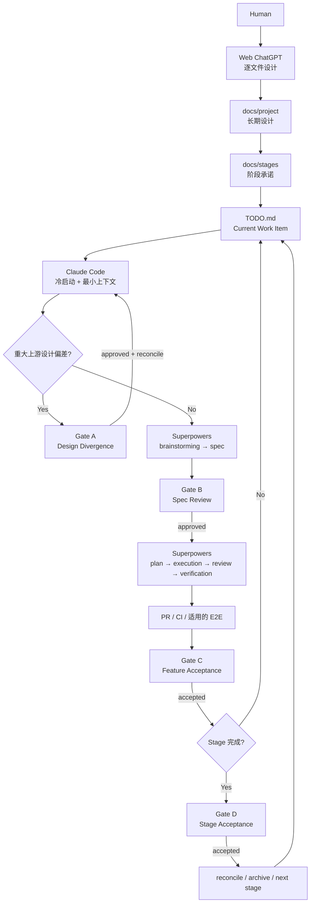

# Cortex Protocol

> **Human intent. Agent execution. Repository truth.**
>
> 一套面向真实软件项目的 Human × AI Agent 协作开发协议：用网页版 ChatGPT 收敛项目设计，用 Repository 保存长期真相与当前状态，用 Claude Code + Superpowers 推进工程实现，并让人只在真正需要判断的 Gate 介入。

## 先选你的入口

### 第一次听说 Cortex Protocol

不要先读规范。按这条路径：

**[`WHY.md`](WHY.md) → [`docs/01-mental-model.md`](docs/01-mental-model.md) → [`tutorial/README.md`](tutorial/README.md)**

你会先理解为什么普通 AI Coding 会逐渐失控，再建立三层设计 + 四个 Human Gate 的心智模型，最后跟着一个 Feedback Inbox 示例完整跑一遍。

### 已经理解，只想装进自己的项目

直接看 **[`START-HERE.md`](START-HERE.md)**，然后把 [`starter-template/`](starter-template/) 合并进真实 Repository。

### 需要查精确定义

看 **[`PROTOCOL.md`](PROTOCOL.md)**。它是规范，不是新手教程。

---

## Cortex Protocol 解决的不是“怎么写一个更长的 Prompt”

AI Coding 在小项目里常见的形态是：

```text
Human → Prompt → Coding Agent → Code
```

项目变大后，真正的问题通常变成：

```text
聊天历史不能稳定保存项目状态
        ↓
新 session 要重新解释项目
        ↓
Prompt 和 CLAUDE.md 越来越长
        ↓
设计、TODO、代码开始漂移
        ↓
Human 开始提醒 Agent 更新文档、测试、Review、PR、归档
        ↓
Human 变成 Workflow Scheduler
```

Cortex Protocol 的核心转变是：

> **Prompt 越来越不重要，Repository state 越来越重要。**

完整推导见 [`WHY.md`](WHY.md)。

## 一张图理解 Cortex Protocol



## 谁负责什么

| 参与者 | 主要职责 | 不应该承担什么 |
|---|---|---|
| **Human** | 产品意图、关键取舍、Spec 批准、Feature/Stage 验收 | 长期提醒 TODO、文档同步、Review 调度等 housekeeping |
| **Web ChatGPT** | 0→1 project-level design convergence | 在 Human 没理解当前层时一次性替人设计整个项目 |
| **Repository** | durable truth + recoverable state | 只当代码存放处 |
| **Claude Code** | 从 Repository 恢复状态并推进 Current Work Item | 静默修改重大上游设计 |
| **Superpowers** | change-level brainstorming、spec、plan、执行、测试、review、verification | 决定整个项目的产品方向 |
| **Human Gates** | 在高价值判断点把控制权交还给 Human | 把每个工程细节都变成人工审批 |

## 四个 Human Gate

| Gate | 触发时机 | Human 只需要回答 |
|---|---|---|
| **A — Design Divergence** | 工程证据与重要上游设计冲突 | 这个已批准设计真的要改吗？ |
| **B — Spec Review** | 当前 Work Item 的 spec 收敛 | 这个系统行为是不是我要的？ |
| **C — Feature Acceptance** | 实现与验证完成 | 这个真实功能是不是我要的？ |
| **D — Stage Acceptance** | Stage 的 Work Items / AC 看起来均满足 | 这一阶段承诺是否完整交付？ |

大量 examples / non-examples 见 [`docs/06-human-gates.md`](docs/06-human-gates.md)。

## 三层设计边界

```text
Project-level design
Human + Web ChatGPT
→ docs/project / docs/stages / TODO.md

Change-level design
Claude Code + Superpowers brainstorming
→ spec

Implementation-level execution
Superpowers plan / TDD / review / verification
→ code + tests + PR
```

这三层不混在一起，才能避免 `TODO.md` 变成函数级任务列表、`CLAUDE.md` 重复 Superpowers、临时实现细节污染长期项目设计。

## 项目结构

```text
cortex-protocol/
├── README.md                    # 项目入口 / 路由
├── WHY.md                       # 从真实失败模式推导 Cortex
├── GLOSSARY.md                  # 新手术语表
├── PROTOCOL.md                  # 核心规范 / Reference
├── START-HERE.md                # 把 Cortex 装进自己的项目
├── tutorial/                    # Guided Tutorial：完整跟做一次
├── docs/                        # 方法论与专题解释
├── prompts/                     # 可复制的交接 Prompt
├── checklists/                  # 启动、Gate、健康检查
├── starter-template/            # 合并进真实 repo 的模板
└── SOURCE-MAP.md                # 原始材料与当前结构映射
```

## Cortex Protocol 不做什么

**不重新实现 Superpowers。** 如果 Superpowers 已经负责 brainstorming、spec、plan、worktree/isolation、TDD、task review、whole-change review、verification 等 change-level 流程，`CLAUDE.md` 不应该再复制一套同类机制。

**不要求每个项目使用同一套设计文档。** `docs/project/` 的数量和主题由项目决定；关键是逐文件收敛、accepted baseline 和上下游一致性。

**不追求 Human 完全退出。** 目标是减少低价值 babysitting，让 Human 把注意力留给真正需要理解、选择、批准、验收的地方。

## 30–60 分钟毕业标准

完成 Guided Tutorial 后，你应该能解释：

1. 为什么项目记忆应该进入 Repository，而不是聊天历史；
2. Project design / Spec / Plan 的区别；
3. 为什么 Spec 要人工审而 Plan 默认不用；
4. 什么情况应该进入 Gate A，什么情况不应该；
5. Gate C 时 Human 到底在验什么；
6. 为什么 TODO 不应该复制 implementation plan；
7. 为什么 Cortex Protocol 不重复 Superpowers；
8. 为什么成熟项目的新 Claude Code session 最终可以只说：**“继续当前 Work Item。”**

如果你还不能稳定回答这些问题，先回到 [`WHY.md`](WHY.md) 和 [`tutorial/README.md`](tutorial/README.md)，而不是继续给 Prompt 加规则。
